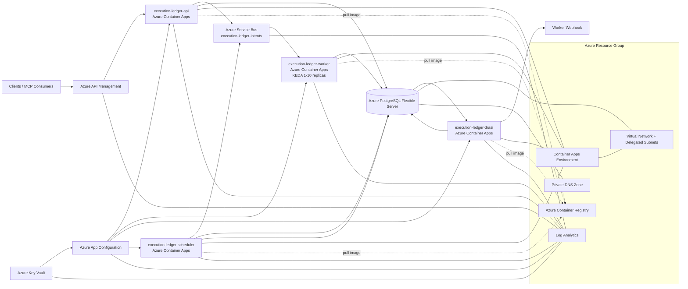
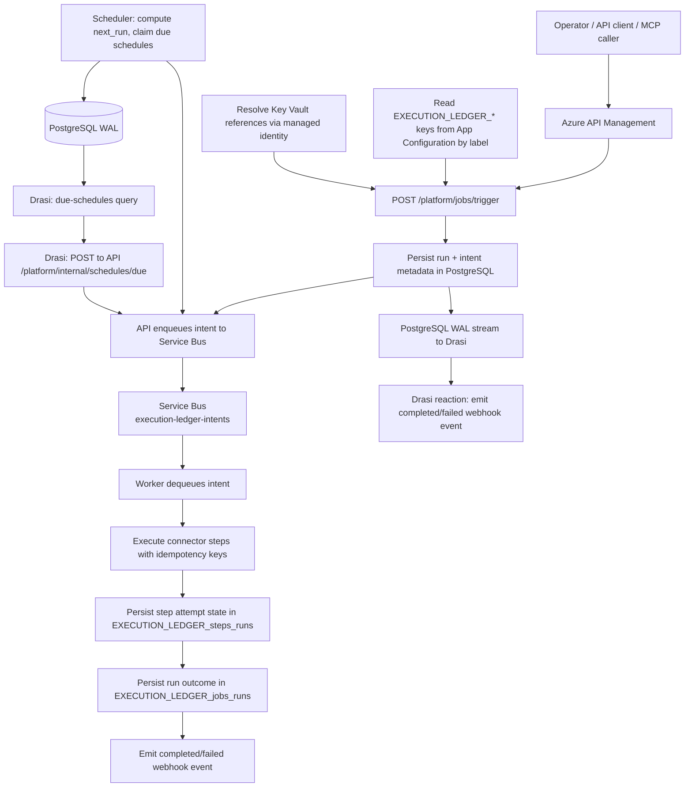

# Execution Ledger

Durable job orchestration for Azure. Step-level idempotency, replay, skip, and compensate controls. Tenant-scoped API with Entra ID auth. Connector packs for ERP, queue, blob, SFTP, and REST integrations. Built for operators who need to recover from failures without manual database surgery.

## Try it locally (no Azure account needed)

The fastest path is a devcontainer that provisions a local Postgres with the settings this project needs (including logical replication for the Drasi WAL reader) and pre-wires the runtime env vars:

1. Open this repo in VS Code and choose **Reopen in Container** (or `devcontainer up` from the CLI). This starts a local Postgres alongside your dev container; see [`.devcontainer/docker-compose.yml`](../.devcontainer/docker-compose.yml).
2. Inside the container:
   ```bash
   cargo run -p execution-ledger-cli -- db-status
   cargo run -p execution-ledger-api &
   cargo run -p execution-ledger-worker &
   cargo run -p execution-ledger-cli -- job-launch <tenant-id> hello-world.health-and-echo '{"steps":[{"id":"health","connector":"platform_health"}]}'
   ```

No `EXECUTION_LEDGER_QUEUE_ENGINE` setting is needed for this. It defaults to `local` (in-database queue, `FOR UPDATE SKIP LOCKED`), and `EXECUTION_LEDGER_ENV` defaults to `local` too. Both only need to be set explicitly when deploying to Azure. See [Run locally](#run-locally) further down for the full command set (recovery, GC, replay/skip/compensate) once you're past the first run.

## Deploy to Azure

Once you're ready to run this for real, against Azure Container Apps, PostgreSQL Flexible Server, and Service Bus:

```bash
azd provision && azd deploy
cargo run -p execution-ledger-cli -- preflight
cargo run -p execution-ledger-cli -- job-launch <tenant-id> hello-world.health-and-echo '{"steps":[{"id":"health","connector":"platform_health"}]}'
```

## What it does

Execution Ledger is a Rust multi-service backend for durable job orchestration, tenant-scoped API access with Microsoft Entra ID, and connector-step execution with replay/idempotency controls.

## Capabilities

- Durable job orchestration with step-level idempotency, replay, skip, and compensate controls.
- Undo committed steps in reverse order when a later step fails through coordinated compensation. The worker queries completed steps from the database, invokes each connector's `compensate()` function, and tracks results. Read-only connectors are no-ops; REST connectors call a configured `compensateUrl`; infrastructure connectors restore state from `stateBlob`.
- Validate step input and output against JSON Schema before and after execution. Every connector step supports optional `inputSchema` and `outputSchema` JSON Schema fields. Validation runs at the pipeline boundary, so every connector gets schema enforcement.
- Flow data between steps. After each step completes, its output becomes `previous_output` for the next step. Connectors capture upstream state (e.g. VM size before resize) into `stateBlob` so compensation can restore it later.
- Tenant-scoped and platform-scoped API surfaces with Entra-backed authorization and protected MCP tool execution.
- Runtime-safe scheduling with cron/timezone support and bounded garbage collection for terminal state.
- Multi-engine intent processing (`local` and `servicebus`) with recovery controls for stale leases and poison queues.
- Operational automation for baseline, soak, chaos, recovery, DR integrity, and capacity/cost gate validation.
- Managed identity-first production posture for Service Bus and secret resolution controls that fail closed.

## Cost estimate (approximate monthly Azure spend)

| Component                   | Small (dev/test) | Medium (production)   | Large (high-throughput) |
| --------------------------- | ---------------- | --------------------- | ----------------------- |
| Container Apps (4 services) | ~$50/mo          | ~$200/mo              | ~$600/mo                |
| PostgreSQL Flexible Server  | ~$50/mo          | ~$200/mo              | ~$500/mo                |
| Service Bus (Standard)      | ~$10/mo          | ~$10/mo               | ~$10/mo + throughput    |
| App Configuration           | ~$5/mo           | ~$5/mo                | ~$5/mo                  |
| Key Vault                   | ~$5/mo           | ~$5/mo                | ~$5/mo                  |
| Log Analytics               | ~$10/mo          | ~$50/mo               | ~$200/mo                |
| APIM (StandardV2)           | ~$250/mo         | ~$250/mo (StandardV2) | ~$300/mo (Premium)      |
| **Total (approx)**          | **~$380/mo**     | **~$790/mo**          | **~$1,920/mo**          |

Costs vary by region, reserved capacity, and actual utilization. Use the [Azure Pricing Calculator](https://azure.microsoft.com/pricing/calculator/) for precise estimates.

> **Note:** APIM StandardV2 is the default deployed SKU (confirmed in production deployment). It provides a 99.95% SLA and no cold-start penalty vs the Developer tier. The higher base cost ($250/mo) reflects these production-grade characteristics.

## How it compares

| Capability                | Execution Ledger                                    | Azure Durable Functions           | Temporal                       | Custom scripts    |
| ------------------------- | --------------------------------------------------- | --------------------------------- | ------------------------------ | ----------------- |
| Step-level replay         | Yes (targeted)                                      | Yes (rewind)                      | Yes (continue-as-new)          | No                |
| Coordinated compensation  | Yes (reverse-order undo)                            | Manual                            | Saga pattern                   | No                |
| Schema validation         | Yes (JSON Schema, per-step)                         | No (manual)                       | No (manual)                    | No                |
| Tenant isolation          | Query-level                                         | Function-level                    | Namespace-level                | Manual            |
| Self-hosted control plane | Yes (Container Apps)                                | No (serverless)                   | Yes (Kubernetes)               | Yes               |
| Connector extensibility   | Pack-based, opt-in                                  | Durable entities                  | Activity functions             | Per-script        |
| Operational recovery APIs | Built-in (replay/skip/compensate)                   | Manual                            | Manual                         | Manual            |
| Chaos/DR proof scripts    | Built-in                                            | No                                | No                             | No                |
| Managed identity-first    | Yes                                                 | Yes (Azure-native)                | No (requires config)           | Varies            |
| Fail-closed connectors    | Yes (enforced)                                      | No (implicit)                     | No (explicit)                  | No                |
| Learning curve            | Medium                                              | Low (Azure-native)                | High (new model)               | Low               |
| Best for                  | Multi-tenant orchestration with recovery guarantees | Serverless event-driven workflows | Complex long-running workflows | Simple automation |

**When to use Execution Ledger:** Multi-tenant workloads needing step-level replay, tenant isolation, and built-in operational recovery. When you need a self-hosted control plane with audit-ready evidence.

**When to use Durable Functions:** Azure-native serverless workflows where lower ops burden matters more than self-hosted control.

**When to use Temporal:** Complex long-running workflows with custom activity patterns and a team comfortable with operational overhead.

**When to use scripts:** Simple, short-lived automation where durability and recovery are not requirements.

## Security posture

Execution Ledger is designed for multi-tenant production workloads where trust boundaries are non-negotiable. These guarantees are built into the runtime, not layered on after deployment:

- Validate Microsoft Entra ID (JWT) tokens on every request. The API validates bearer tokens at the middleware layer before any route handler runs. Tokens must carry scopes matching the route (e.g. `jobs:read:own`, `platform:write`, `mcp:execute`). Invalid or missing tokens are rejected with no fallback path.
- Enforce tenant-scoped data isolation. Every run, step, and schedule record is scoped to a tenant ID extracted from the validated token. One tenant cannot read, replay, skip, or compensate another tenant's runs. The API enforces this at the query level, not just the route level.
- Use managed identity-first for all Azure services. Service Bus, Key Vault, and App Configuration connections use managed identity by default. No connection strings or access keys are required in production. Secret resolution happens at startup through Key Vault references in App Configuration, and the process fails closed if any required secret is missing or invalid.
- Fail closed by default. If a connector is missing required configuration, it fails the step. It does not silently degrade or fall back to an unsafe default. If multi-revision workers hit a Postgres replication slot conflict, queue processing continues while Drasi is skipped for that replica, with no crash loop and no silent data loss.
- Keep no secret material in environment variables at runtime. Bootstrap env vars carry only non-secret configuration (database URL, App Config endpoint, Entra audience). Secrets are resolved from Key Vault via managed identity at startup. Local/dev fallback maps (`EXECUTION_LEDGER_KEY_VAULT_SECRETS_JSON`) are explicitly rejected in `prod`/`prd`/`production` environments.

## Operational maturity

Most orchestration platforms add recovery and observability after the first production incident. Execution Ledger ships these capabilities as first-class features:

- Route invalid or unprocessable intents to dead-letter paths for poison queue recovery. The CLI and API expose `recovery-local-poison` and `recovery-servicebus-poison` endpoints to drain, inspect, and reprocess these messages without manual database surgery.
- Recover stale leases. When a worker crashes or loses connectivity mid-execution, the run-level and schedule-level leases remain locked. The `recovery-runs` and `recovery-schedules` endpoints detect and release stale leases so work can resume.
- Run bounded garbage collection. Terminal runs, stale scheduler ticks, and expired KV entries accumulate over time. The `/platform/gc` endpoint and `gc-run` CLI command clean up this state with configurable retention bounds.
- Enforce step-level idempotency and replay. Every connector step carries an idempotency key. Replaying a step re-executes only the targeted step. Other steps in the run are untouched. This makes incident recovery precise rather than all-or-nothing.
- Validate chaos and DR integrity. Operational proof scripts (`Invoke-OperationalProofRun.ps1`, `Invoke-PostgresFlexibleServerFault.ps1`, `Invoke-DrIntegrityPass.ps1`) exercise real Azure faults (Service Bus queue state disruption, PostgreSQL restart/failover) and collect pass/fail evidence. DR integrity checks validate baseline preconditions and fail closed when any invariant is `Fail` or `Blocked`.
- Propagate correlation IDs on every run. A correlation ID is set at run creation and propagated into every step execution context and output. This makes tracing a single request across API, worker, scheduler, and webhook endpoints easy in Log Analytics.

## Connector model

Connectors are the execution boundary between Execution Ledger and external systems. The design prioritizes correctness and predictability over breadth:

- Execute real paths, not stubs. Every core connector contains actual implementation logic. Missing configuration returns an explicit error, never a success response or silent skip.
- Validate schemas at the pipeline boundary. Every connector step supports optional `inputSchema` and `outputSchema` JSON Schema fields. Validation runs in `execute_step()` before and after connector execution. A step that fails schema validation never reaches the connector, and a connector that produces invalid output fails the step before the caller sees the result.
- Flow data between steps. After each step completes, its output becomes `ctx.previous_output` for the next step. Connectors read upstream state to capture it into their own output (as `stateBlob`) so compensation can restore it later. This enables pipeline composition without manual wiring.
- Compensate using a save-then-restore pattern. Every connector implements a `compensate()` function. Read-only connectors are no-ops. REST connectors call a configured `compensateUrl`. Infrastructure connectors (azure_compute, azure_sql) read the `stateBlob` captured from a prior get-step and call the reverse resize action. When the worker processes a `target.compensate` intent, it queries completed steps in reverse order and invokes compensation. See `connectors/mod.rs` for the implementation template.
- Package integrations as connector packs. The base platform handles scheduling, orchestration, idempotency, and recovery. Customer-specific integrations are added as separate packs under `connector-packs/`.

## Who uses this

- Teams running ERP integrations, queue-based processing, blob transfers, or REST orchestration that need to survive failures without manual intervention.
- Organizations that need audit trails for every step: who ran what, when, and whether it succeeded or was compensated.
- Platforms with multiple tenants where one tenant's jobs must never leak into another's data or control plane.
- Teams replacing cron scripts or legacy schedulers with a service that has replay, skip, and compensate controls built in.

## Scenario-based usage

- Replace timer polling with change-driven orchestration by streaming WAL changes from PostgreSQL through Drasi and reacting only when tracked state changes.
- Extend the same change-driven pattern to storage-account events by implementing `blob`/event connectors, so orchestration can react to object changes instead of polling loops.
- Run high-volume back-office processing with `servicebus` intent dispatch, tenant-scoped run controls, and replay/skip/compensate operator actions.
- Trigger repeatable business jobs on cron/timezone schedules for workflows that are time-based rather than change-based.
- Expose approved operator actions through MCP (`/api/mcp/server`) so internal copilots can execute bounded operations with OAuth scopes.
- Use recovery APIs and CLI actions during incidents to clear stale leases, drain poison queues, and restore queue processing without manual database surgery.

## Connector packs (optional add-ons)

- Keep the base platform focused on shared runtime guarantees, then ship customer-specific integrations as additive connector packs.
- Put each pack under a separate boundary with its own connector definitions, configuration contract, tests, and rollout/runbook docs.
- Treat packs as opt-in deployment units so organizations can add regulated, partner, or line-of-business connectors without changing the base runtime contract.
- Require the same fail-closed behavior as core connectors: no silent fallback, explicit secret and identity validation, and deterministic replay/idempotency outcomes.
- Use `connector-packs/README.md` for the pack folder contract and `connector-packs/example-finance-settlement-pack/` as the scaffold baseline.

## Common scenarios and edge cases

- Duplicate or repeated triggers are contained by step-level idempotency and replay targeting, so the same logical step is not re-applied accidentally.
- Worker restarts or lease interruption are handled through run/schedule lease recovery controls and bounded garbage collection for terminal state.
- Invalid intents are fail-closed and routed to poison/dead-letter handling paths (`local` poison drain and Service Bus poison drain/recovery flows).
- Multi-revision worker startup can hit replication-slot ownership conflicts; in that case queue processing continues and Drasi startup is skipped for that replica instead of crash-looping.
- Service Bus queue-state disruption is covered by chaos/recovery operational proof, with queue state restore and explicit runbook evidence.
- Connector boundaries are explicit and execute real connector logic: `platform_health`, `rest`, `ms_graph_notify`, `queue`, `azure_blob`, `sftp`, `erp`, `azure_compute`, `azure_sql`, and `transform`.
- Storage-account change-driven orchestration can be built by pairing blob/event ingestion with ledger-triggered runs, so polling loops stay optional rather than required.

## MCP endpoint (AI copilot integration)

Execution Ledger exposes a Model Context Protocol (MCP) endpoint at `/api/mcp/server`. It follows the 2025-11-25 protocol version with streamable HTTP transport. AI copilots, Foundry agents, and MCP-compatible tools can query runs, inspect steps, manage schedules, and run recovery operations through this endpoint, all scoped by Entra ID permissions.

### Connecting a consumer

```
Endpoint:  https://<apim-gateway>/execution-ledger/api/mcp/server
Protocol:  MCP 2025-11-25 (streamable HTTP, stateless)
Auth:      Bearer <entra-access-token>
Scope:     mcp:execute (required for all tools)
           + jobs:read:own or jobs:read:any (job tools)
           + platform:read (schedule listing)
           + platform:write (schedule enable/disable, recovery)
```

### Tool reference

Each tool exposes `title`, `description`, `inputSchema`, and `annotations` (readOnlyHint, destructiveHint, idempotentHint). Tools are scope-gated: `tools/list` returns only tools the caller's token entitles them to use.

| Tool                                 | Scope            | Annotations                 | Arguments                              | Returns                                              |
| ------------------------------------ | ---------------- | --------------------------- | -------------------------------------- | ---------------------------------------------------- |
| `execution_ledger.health`            | `mcp:execute`    | read-only, idempotent       | N/A                                    | `{ status, environment }`                            |
| `execution_ledger.jobs.get`          | `jobs:read:*`    | read-only, idempotent       | `{ runId: string }`                    | `{ id, jobId, status, currentAttempt, maxAttempts }` |
| `execution_ledger.jobs.list`         | `jobs:read:*`    | read-only, idempotent       | `{ status?: string, limit?: integer }` | `{ runs: [...], count }`                             |
| `execution_ledger.jobs.get_steps`    | `jobs:read:*`    | read-only, idempotent       | `{ runId: string }`                    | `{ steps: [...], count }`                            |
| `execution_ledger.schedules.list`    | `platform:read`  | read-only, idempotent       | `{ limit?: integer }`                  | `{ schedules: [...], count }`                        |
| `execution_ledger.schedules.enable`  | `platform:write` | read-write, non-destructive | `{ schedulerId: string }`              | `{ schedulerId, status: "ACTIVE" }`                  |
| `execution_ledger.schedules.disable` | `platform:write` | read-write, non-destructive | `{ schedulerId: string }`              | `{ schedulerId, status: "DISABLED" }`                |
| `execution_ledger.recovery.runs`     | `platform:write` | destructive                 | `{ limit?: integer }`                  | `{ requeuedPending, failedTerminal }`                |

All tools return JSON-RPC 2.0 responses. Errors use standard MCP error codes: `-32601` (tool not found), `-32602` (invalid params), `-32000` (database error), `-32003` (forbidden), `-32004` (not found).

### Example: list failed runs

```json
// Request
{ "jsonrpc": "2.0", "id": 1, "method": "tools/call", "params": {
  "name": "execution_ledger.jobs.list",
  "arguments": { "status": "failed", "limit": 10 }
}}

// Response
{ "jsonrpc": "2.0", "id": 1, "result": {
  "tool": "execution_ledger.jobs.list",
  "content": [{ "type": "json", "json": {
    "runs": [
      { "id": "abc-123", "job_id": "invoice-gen", "status": "failed", "current_attempt": 3, "max_attempts": 3, "created_at": "2026-07-26T02:00:00Z" }
    ],
    "count": 1
  }}]
}}
```

### Capability discovery

```json
// Request
{ "jsonrpc": "2.0", "id": 1, "method": "tools/list" }

// Response (partial; tools vary by caller's scopes)
{ "jsonrpc": "2.0", "id": 1, "result": {
  "tools": [
    { "name": "execution_ledger.health", "description": "Return platform health status" },
    { "name": "execution_ledger.jobs.list", "description": "List job runs. Filter by status..." }
  ]
}}
```

Tools are scope-gated: callers only see tools their token entitles them to use. A token with only `mcp:execute` sees only `execution_ledger.health`. A token with `platform:write` sees the full 8-tool surface.

### OAuth protected resource metadata

```
GET /.well-known/oauth-protected-resource
```

Returns the MCP resource URL and authorization server endpoints for OAuth 2.0 protected resource metadata discovery (RFC 9728). Configure via `EXECUTION_LEDGER_MCP_RESOURCE_URL` and `EXECUTION_LEDGER_MCP_AUTHORIZATION_SERVERS` in App Configuration.

## What this solution does

- Serves API endpoints for health and tenant-scoped job-run lookup.
- Serves protected platform endpoints for route definitions, job trigger dispatch, run listing, step inspection, and operator controls (`/platform/definitions`, `/platform/jobs/trigger`, `/platform/jobs`, `/platform/jobs/{id}/steps`, `/platform/jobs/{id}/replay`, `/platform/jobs/{id}/skip`, `/platform/jobs/{id}/compensate`).
- Serves protected platform GC endpoint (`/platform/gc`) for bounded cleanup of terminal runs, stale schedules, and expired KV.
- Serves protected MCP endpoints (`/api/mcp/server`) with OAuth protected-resource metadata and scope-aware tool discovery/calls.
- Serves internal endpoints (`/platform/internal/schedules/due`) for Drasi-to-API reactive schedule enqueue with gateway-secret Bearer auth.
- Boots and maintains runtime Postgres schema tables for runs, attempts, steps, schedules, scheduler ticks/control, KV, API clients, and local intent queue.
- Streams WAL changes from Postgres via the Drasi service and pushes completed/failed job-run events to the configured delivery target (Event Grid or webhook). Drasi also provides a secondary catch-up path for schedule enqueuing via `/platform/internal/schedules/due`.
- Runs a scheduler loop for periodic orchestration ticks and cron/timezone next-run computation.
- Runs a durable intent worker loop with `local` and `servicebus` queue engines, per-replica bounded concurrency (default 5), step-level idempotency keys, replay-aware step execution, and run-level correlation IDs.
- Executes connector-step boundaries via `execution-ledger-domain::connectors` (`platform_health`, `rest`, `ms_graph_notify`, `queue`, `azure_blob`, `sftp`, `erp`, `azure_compute`, `azure_sql`, `transform`).

## Services

- `execution-ledger-api`: Axum HTTP API with Entra JWT validation and tenant authorization.
- `execution-ledger-worker`: Durable intent worker with per-replica bounded concurrency (Service Bus or local queue).
- `execution-ledger-drasi`: PostgreSQL WAL reader (singleton) that streams completed/failed job-run events to a webhook via Drasi.
- `execution-ledger-scheduler`: Claims due schedules with `FOR UPDATE SKIP LOCKED`, enqueues intents directly to Service Bus, and advances `next_run` from cron expressions. Drasi monitors schedule records via the WAL for reactive enqueue as a secondary path.
- `execution-ledger-cli`: operational CLI for db/kv/scheduler/job launch/schedule release + replay/skip/compensate workflows.
- `execution-ledger-core`: shared config, auth, DB bootstrap, and typed error layer.
- `execution-ledger-domain`: domain services and connector-step boundary execution.

## Architecture



### Execution flow (start to finish)



### Scaling model

Execution Ledger scales horizontally through worker replicas and vertically through Service Bus queue depth. Each component has a distinct scaling behaviour:

#### How each service scales

| Service         | Scaling model                                                                          | Default range | Scaling unit                       |
| --------------- | -------------------------------------------------------------------------------------- | ------------- | ---------------------------------- |
| **API**         | Fixed replicas behind APIM load balancer                                               | 1–3           | Concurrent HTTP requests           |
| **Worker**      | KEDA autoscale on Service Bus queue depth; per-replica bounded concurrency (default 5) | 1–10          | Concurrent intent processing tasks |
| **Drasi**       | Singleton (WAL replication slot ownership)                                             | 1             | PostgreSQL change events → webhook |
| **Scheduler**   | Singleton (lease-based; claims due schedules, enqueues directly to Service Bus)        | 1             | Schedule records updated per tick  |
| **Service Bus** | Managed by Azure (Standard SKU, partitioned)                                           | N/A           | Partitioned brokers                |
| **PostgreSQL**  | Flexible Server (SKU-dependent connection limit)                                       | N/A           | `max_connections` per SKU          |

#### Worker scaling mechanics

Each worker replica runs up to `EXECUTION_LEDGER_WORKER_MAX_CONCURRENT_INTENTS` (default 5) intent processing tasks concurrently, gated by a semaphore. Each task claims one intent, executes its connector steps sequentially, persists state, and acks. Parallelism comes from **multiple concurrent tasks per replica** plus **multiple replicas** competing for intents via `FOR UPDATE SKIP LOCKED` (local queue) or Service Bus receive.

- In Service Bus mode, KEDA monitors queue depth and scales replicas to maintain `messageCount: 25` messages per replica. At 10 replicas × ~20 intents/sec each, the theoretical ceiling is ~200 intents/sec.
- In local queue mode, use fixed 1–2 replicas. The local intent table uses the same `FOR UPDATE SKIP LOCKED` pattern, so multiple replicas safely claim different intents without coordination.

Steps within a single intent execute **sequentially**. This is intentional. Connector steps in a run may depend on prior step output (e.g. a file path from step 1 used in step 2). Cross-run parallelism is horizontal via replicas.

#### Scaling tiers

| Load                | What happens                                                                          | What to tune                                                                                     |
| ------------------- | ------------------------------------------------------------------------------------- | ------------------------------------------------------------------------------------------------ |
| **1–10 jobs/sec**   | 1–2 worker replicas, trivial load                                                     | Nothing. Default config handles this                                                             |
| **10–50 jobs/sec**  | KEDA scales to 2–5 workers; per-replica concurrency handles bursts                    | Monitor queue depth and replica count in Log Analytics                                           |
| **50–500 jobs/sec** | KEDA hits `maxReplicas: 10` ceiling, 5 concurrent per replica = 50 concurrent intents | Increase `workerScaleMaxReplicas` (up to 30) or `EXECUTION_LEDGER_WORKER_MAX_CONCURRENT_INTENTS` |
| **500+ jobs/sec**   | Service Bus throughput becomes bottleneck                                             | Upgrade to Premium; increase API replicas; tune PG `max_connections`                             |

#### Connection pool sizing

Each service opens a PostgreSQL connection pool. The pool defaults to 10 connections (`sqlx` default). With N worker replicas, total PG connections ≈ N × pool_size. Azure PostgreSQL Flexible Server connection limits by SKU:

| SKU tier                | `max_connections` |
| ----------------------- | ----------------- |
| Burstable B1ms          | 97                |
| General Purpose D2s_v5  | 97                |
| Memory Optimized E2s_v5 | 97                |

Set `EXECUTION_LEDGER_PG_MAX_CONNECTIONS` per service to stay within the PG limit. Set the worker pool size ≥ `concurrent intents + 2` to avoid pool exhaustion during concurrent processing. Example: 10 workers × 7 connections = 70 + 3 API + 1 scheduler + 1 drasi = 75 (under 97).

#### Drasi (WAL reader)

The `execution-ledger-drasi` service runs as a **singleton** Container App (`minReplicas: 1, maxReplicas: 1`). It holds a PostgreSQL logical replication slot (`execution_ledger_worker_slot`) and streams WAL changes for `EXECUTION_LEDGER_jobs_runs` to the configured webhook URL. This is architecturally a single-replica component; PostgreSQL replication slots are inherently single-consumer, so it does not use KEDA autoscale.

The Drasi service was split from the worker in the scaling refactor. Previously, one worker replica held the slot while others skipped Drasi startup. Now the Drasi reader runs independently, and worker replicas are pure intent processors with no WAL-reading overhead.

#### Scheduler singleton

The scheduler uses `FOR UPDATE SKIP LOCKED` to safely claim due schedules, so it _could_ run as multiple replicas. The current Bicep config constrains it to `maxReplicas: 1` because the scheduler only enqueues intents. The real work is done by workers. If the scheduler tick becomes a bottleneck (thousands of cron schedules), increase `maxReplicas` and the `CLAIM_LIMIT` constant.

### Gateway and config bootstrap notes

- APIM forwards `GET`, `POST`, and `DELETE` paths to the backend API and injects `x-execution-ledger-gateway-secret` from a named value policy.
- API, worker, and scheduler start with a minimal bootstrap env set, then load `EXECUTION_LEDGER_*` runtime keys from App Configuration by label.
- Key Vault references in App Configuration are resolved at startup via managed identity, and startup fails closed when required keys are missing or invalid.

## Required environment variables

Bootstrap runtime env vars in Container Apps:

- `EXECUTION_LEDGER_DATABASE_URL`
- `EXECUTION_LEDGER_ENTRA_AUDIENCE` (optional; leave unset to let infra auto-provision and emit the environment-specific audience)
- `EXECUTION_LEDGER_APP_CONFIG_ENDPOINT`
- `EXECUTION_LEDGER_ENV` (label selector; defaults to `local`)

Optional bootstrap overrides:

- `EXECUTION_LEDGER_APP_CONFIG_LABEL` (override label used when reading App Configuration)
- `EXECUTION_LEDGER_APP_CONFIG_JSON` (local-only fallback key/value map when no App Configuration endpoint is set)
- `EXECUTION_LEDGER_KEY_VAULT_SECRETS_JSON` (local/dev-only secret map for `<secret:...>` markers; rejected in `prod`/`prd`/`production`)
- `EXECUTION_LEDGER_VAULT_SECRETS_JSON` (local/dev-only legacy secret map; rejected in `prod`/`prd`/`production`)
- `EXECUTION_LEDGER_OFFLOAD_DIR` (worker local payload offload directory)

Runtime config comes from Azure App Configuration (`EXECUTION_LEDGER_*` keys by label). Secret keys are Key Vault references resolved at startup through managed identity.

### Required Entra scopes

Bearer tokens must include scopes (or app roles) that match the route:

- Tenant run reads (`GET /jobs/*`, `GET /platform/jobs*`): `jobs:read:own` (or `jobs:read:any`, `platform:read`, `platform:write`)
- Tenant run mutations (`POST /platform/jobs/*`): `jobs:write:own` (or `platform:write`)
- Platform reads (`GET /platform/health`, `/platform/definitions`): `platform:read` (or `platform:write`)
- Platform writes (`POST /platform/gc`, `/platform/recovery/*`): `platform:write`
- MCP (`/api/mcp/server`): `mcp:execute`

## Contract naming

Execution Ledger uses the `EXECUTION_LEDGER_*` contract prefix across environment variables, tables, and runtime events.

## Run locally

```bash
cargo run -p execution-ledger-api
cargo run -p execution-ledger-worker
cargo run -p execution-ledger-scheduler
cargo run -p execution-ledger-cli -- db-status
cargo run -p execution-ledger-cli -- gc-run
cargo run -p execution-ledger-cli -- recovery-runs
cargo run -p execution-ledger-cli -- recovery-schedules
cargo run -p execution-ledger-cli -- recovery-local-poison
cargo run -p execution-ledger-cli -- recovery-servicebus-poison
cargo run -p execution-ledger-cli -- job-launch <tenant-id> <job-id> '{"steps":[{"id":"health","connector":"platform_health"}]}'
cargo run -p execution-ledger-cli -- job-replay <tenant-id> <run-id> health
cargo run -p execution-ledger-cli -- job-skip <tenant-id> <run-id> "manual test skip"
cargo run -p execution-ledger-cli -- job-compensate <tenant-id> <run-id> '{"reason":"reverse transfer"}'
```

### Tauri management/testing surface

Use the API (not direct DB access) for the Tauri operator UI. The desktop shell is intentionally
single-window and Copilot-inspired: left rail, focused work surface, and a compact command area.

- `GET /platform/jobs?limit=50`
- `GET /platform/jobs/{id}/steps`
- `POST /platform/jobs/trigger`
- `POST /platform/jobs/{id}/replay`
- `POST /platform/jobs/{id}/skip`
- `POST /platform/jobs/{id}/compensate`
- `POST /platform/recovery/runs?limit=500`
- `POST /platform/recovery/schedules?limit=200`
- `POST /platform/recovery/local-poison?limit=500`
- `POST /platform/recovery/servicebus-poison?limit=200`

This is the intended replacement path for most CLI operational actions in desktop workflows.

The recommended architecture for Tauri integration:

1. Tauri frontend (web UI) calls a Tauri Rust backend command
2. Backend command injects the Entra auth token and required headers
3. Backend command calls the Execution Ledger API over HTTPS
4. UI polls run status or consumes push events

What to avoid in Tauri clients:

- Never embed Postgres credentials in desktop clients
- Never bypass API auth and tenant checks by calling the database or worker directly
- Never put APIM shared secrets in frontend JavaScript; keep them in the backend or APIM only

The implemented desktop app is in `tauri-operator/`:

```bash
cd tauri-operator
npm install
npm run tauri dev
```

For admin onboarding and connection setup, see `tauri-operator/README.md`.

The current showcase flows are:

- BizTalk-style bank file migration
- Drasi-enhanced change reaction

### Connector-step reference (current core connectors)

For an overview of the connector model and how to add new connectors, see the [Connector model](#connector-model) section above.

| Connector         | What it does                                                                                                                                                                      | Fail-closed behavior                                                                                                    | Compensation                                                                                          |
| ----------------- | --------------------------------------------------------------------------------------------------------------------------------------------------------------------------------- | ----------------------------------------------------------------------------------------------------------------------- | ----------------------------------------------------------------------------------------------------- |
| `platform_health` | Validates platform connectivity and readiness (`health-check`), or polls `/health` and alerts via `ms_graph_notify` if Drasi's heartbeat has gone stale (`drasi-heartbeat-check`) | Fails step if any health check returns unhealthy, or if `drasi-heartbeat-check`'s `healthUrl`/`alert` config is missing | No-op for `health-check`; `drasi-heartbeat-check` may have already sent a real alert, not retractable |
| `rest`            | Executes HTTP requests to external APIs                                                                                                                                           | Fails step if required URL, auth, or headers are missing                                                                | Calls `compensateUrl` if configured, otherwise no-op                                                  |
| `ms_graph_notify` | Sends Teams channel messages and Outlook emails via Microsoft Graph (managed identity)                                                                                            | Fails step if target-specific fields are missing or Graph call fails                                                    | No-op (external notifications are not auto-retracted)                                                 |
| `queue`           | Sends or receives messages from queue systems                                                                                                                                     | Fails step if queue connection or credentials are invalid                                                               | No-op (messages cannot be recalled)                                                                   |
| `azure_blob`      | Reads or writes objects in blob storage                                                                                                                                           | Fails step if storage account or container config is missing                                                            | No-op (deletion is destructive)                                                                       |
| `sftp`            | Transfers files over SFTP                                                                                                                                                         | Fails step if host, credentials, or path config is missing                                                              | No-op (deletion is destructive)                                                                       |
| `erp`             | Executes ERP integration steps                                                                                                                                                    | Fails step if ERP connection or required fields are missing                                                             | Calls `compensateUrl` if configured, otherwise no-op                                                  |
| `transform`       | Reshapes JSON between steps with dot-notation field mapping                                                                                                                       | Fails step if `map` config is present but not a JSON object                                                             | Restores original input (pure data, fully reversible)                                                 |
| `azure_compute`   | Resizes VM, VMSS, and App Service Plan via ARM API                                                                                                                                | Fails step if subscription, resource group, or target SKU is missing                                                    | Restores previous SKU from `stateBlob` captured by prior get-step                                     |
| `azure_sql`       | Resizes SQL Database and Elastic Pool via ARM API                                                                                                                                 | Fails step if subscription, resource group, or target SKU is missing                                                    | Restores previous SKU from `stateBlob` captured by prior get-step                                     |
| `ftp`             | Transfers files over plain (unencrypted) FTP, for endpoints with no SSH server                                                                                                    | Fails step if host, username, or path config is missing                                                                 | No-op (deletion is destructive)                                                                       |
| `batch_window`    | Correlates arrivals sharing a `windowKey` into one window, released by time or `expectedCount`                                                                                    | Fails step if `windowKey`, `jobId`, `windowMinutes`, or the internal API URL is missing                                 | No-op (item already merged into a shared window)                                                      |

Each connector execution is governed by:

- Use an idempotency key derived from run ID + step ID; re-executing the same step produces the same outcome.
- Target replay via `target.replay.stepIds` to select which step(s) to re-execute; other steps in the run are untouched.
- Validate schemas using optional `inputSchema` and `outputSchema` fields that validate payloads before and after connector execution. Fails the step at the pipeline boundary, never inside the connector.
- Flow data between steps. After each step completes, its output becomes `ctx.previous_output` for the next step. Connectors capture upstream state into `stateBlob` for compensation.
- Propagate a correlation ID from the run into step execution context and output for end-to-end traceability.

### Runtime behavior note (Drasi WAL reader)

The `execution-ledger-drasi` service is a singleton Container App that reads PostgreSQL WAL changes via a logical replication slot and pushes completed/failed job-run events to the configured delivery target (prefers Event Grid with managed identity; falls back to raw webhook URL). It is independent of the worker replicas. If the Drasi service restarts, intent processing continues uninterrupted and the replication slot preserves the last-acknowledged position so no WAL data is lost.

The Drasi `due-schedules` query provides a secondary reactive enqueue path: it detects schedule records that are already past their `next_run` at the moment the WAL change occurs (startup snapshot, or after the scheduler updates a row). The primary schedule enqueue path is the scheduler's 60-second tick calling Service Bus directly. Drasi cannot replace timer-based scheduling because it only re-evaluates queries on WAL changes, not on time passage.

## Deploy with Azure Developer CLI (azd)

This repo now includes AZD + Bicep deployment assets at the repository root:

- `../azure.yaml`
- `../infra/main.bicep`
- `../infra/main.parameters.json`
- Service Dockerfiles under `crates/execution-ledger-*/Dockerfile`

Set required AZD environment values before provisioning/deploy:

- `AZURE_LOCATION`
- `POSTGRES_ADMIN_LOGIN`
- `POSTGRES_ADMIN_PASSWORD`
- `POSTGRES_DATABASE_NAME` (e.g. `executionledger`)
- `EXECUTION_LEDGER_ENTRA_AUDIENCE`
- `EXECUTION_LEDGER_WORKER_WEBHOOK_URL`
- `EXECUTION_LEDGER_API_INTERNAL_URL` (optional; enables Drasi → API schedule-enqueue catch-up path; set to `https://<api-container-app>.internal.<env>.<region>.azurecontainerapps.io/platform/internal/schedules/due`)
- `EXECUTION_LEDGER_API_INTERNAL_BATCH_WINDOWS_DUE_URL` (optional; enables Drasi → API batch-window release path; set to the same internal host with `/platform/internal/batch-windows/due`)
- `EXECUTION_LEDGER_API_INTERNAL_BATCH_WINDOWS_ADD_ITEM_URL` (required if using the `batch_window` connector; set to `/platform/internal/batch-windows/add-item` on the same internal host, or pass `apiUrl` per-step in job config instead)
- `EXECUTION_LEDGER_API_HEALTH_URL` (required if using the `platform_health.drasi-heartbeat-check` action; the platform's own `/health` URL, or pass `healthUrl` per-step in job config instead)
- `EXECUTION_LEDGER_APIM_GATEWAY_SECRET` (optional)
- `EXECUTION_LEDGER_APIM_PUBLISHER_NAME`
- `EXECUTION_LEDGER_APIM_PUBLISHER_EMAIL`
- `EXECUTION_LEDGER_MCP_RESOURCE_URL` (optional)
- `EXECUTION_LEDGER_MCP_AUTHORIZATION_SERVERS` (optional)
- `EXECUTION_LEDGER_OFFLOAD_INLINE_MAX_BYTES` (optional, default `5120`)

Deploy:

```bash
azd provision
azd deploy
```

The `postprovision` hook (`infra/scripts/Add-DeployingUserToAdminGroup.ps1`) creates or updates the Entra app registration, resolves the app client ID GUID, and syncs it to:

- `EXECUTION_LEDGER_ENTRA_AUDIENCE` in the azd environment (the canonical audience for all token validation)
- The APIM named value `entra-audience`
- The `EXECUTION_LEDGER_ENTRA_AUDIENCE` env var on all four Container Apps

You do not need to set `EXECUTION_LEDGER_ENTRA_AUDIENCE` manually before the first deploy. It is auto-provisioned and synced by the postprovision hook.

## Functional testing

### From the command line

After `azd up` completes and the postprovision hook has run, verify end-to-end auth and basic platform function with:

```bash
# 1. Get connection details
APIM_URL=$(azd env get-value apimGatewayUrl)
AUDIENCE=$(azd env get-value EXECUTION_LEDGER_ENTRA_AUDIENCE)
ID_URI=$(az ad app show --id "$AUDIENCE" --query identifierUris[0] --output tsv 2>/dev/null || echo "$AUDIENCE")

# 2. Acquire a token (interactive login, scoped to the app)
TOKEN=$(az account get-access-token --resource "$ID_URI" --query accessToken --output tsv)

# 3. Health check (no auth required)
curl -sS "$APIM_URL/execution-ledger/health" | jq .

# 4. List platform jobs (requires platform:read scope)
curl -sS -H "Authorization: Bearer $TOKEN" \
  "$APIM_URL/execution-ledger/platform/jobs?limit=10" | jq .

# 5. Trigger a test job (requires platform:write scope)
curl -sSX POST -H "Authorization: Bearer $TOKEN" \
  -H "Content-Type: application/json" \
  -d '{"definition_id":"hello-world.health-and-echo","triggered_by":"cli-smoke-test"}' \
  "$APIM_URL/execution-ledger/platform/jobs/trigger" | jq .

# 6. List runs after trigger to confirm the new run appears
RUN_ID=$(curl -sS -H "Authorization: Bearer $TOKEN" \
  "$APIM_URL/execution-ledger/platform/jobs?limit=1" | jq -r '.[0].id // empty')

# 7. Inspect steps for the run
[ -n "$RUN_ID" ] && curl -sS -H "Authorization: Bearer $TOKEN" \
  "$APIM_URL/execution-ledger/platform/jobs/$RUN_ID/steps" | jq .
```

**PowerShell (Windows):**

```powershell
$apimUrl = azd env get-value apimGatewayUrl
$audience = azd env get-value EXECUTION_LEDGER_ENTRA_AUDIENCE
$idUri = az ad app show --id $audience --query 'identifierUris[0]' --output tsv 2>$null
if (-not $idUri) { $idUri = $audience }

$token = az account get-access-token --resource $idUri --query accessToken --output tsv

# Health
Invoke-RestMethod "$apimUrl/execution-ledger/health"

# List jobs
Invoke-RestMethod -H @{Authorization="Bearer $token"} "$apimUrl/execution-ledger/platform/jobs?limit=10"

# Trigger a job
$run = Invoke-RestMethod -Method Post -H @{Authorization="Bearer $token"} `
  -ContentType application/json `
  -Body '{"definition_id":"hello-world.health-and-echo","triggered_by":"ps-smoke-test"}' `
  "$apimUrl/execution-ledger/platform/jobs/trigger"
Write-Host "Run ID: $($run.id ?? $run)"

# Inspect steps (after worker picks up the intent, typically < 5 seconds)
Start-Sleep 5
Invoke-RestMethod -H @{Authorization="Bearer $token"} `
  "$apimUrl/execution-ledger/platform/jobs/$($run.id ?? $run)/steps"
```

**Expected outcomes:**

| Step                            | Expected response                                                  |
| ------------------------------- | ------------------------------------------------------------------ |
| `/health`                       | `{"status":"ok","environment":"<env>"}`                            |
| `GET /platform/jobs`            | `[]` on a fresh deploy; array of run objects after trigger         |
| `POST /platform/jobs/trigger`   | `{"id":"<uuid>"}` (run ID) or `202 Accepted`                       |
| `GET /platform/jobs/{id}/steps` | Array of step records with `status`, `connector`, `attempt` fields |

If you get 401: run `azd env get-value EXECUTION_LEDGER_ENTRA_AUDIENCE` and confirm it matches the `aud` claim in your token (decode at [jwt.ms](https://jwt.ms)). If they differ, re-run `infra/scripts/Add-DeployingUserToAdminGroup.ps1` to resync.

If you get 403: your user's Entra tenant has not been bootstrapped. On first request, the API auto-bootstraps the home tenant (set to `subscription().tenantId` by Bicep). Retry once; if 403 persists, check that `EXECUTION_LEDGER_HOME_TENANT_ID` is set on the Container App and matches your tenant ID.

### Using the Tauri operator app

The Tauri desktop app in `tauri-operator/` is the recommended way for operators and testers to interact with a deployed environment.

**Start the app:**

```bash
cd tauri-operator
npm install          # first time only
npm run tauri dev    # dev build with hot reload
# or: npm run tauri build -- --debug   # installable package
```

**First-time connection setup:**

1. In the **Connection** panel, set:

- **API base URL**: the APIM gateway URL from `azd env get-value apimGatewayUrl`, with the `/execution-ledger` prefix (for example, `https://apim-<name>.azure-api.net/execution-ledger`)
- **Bearer token**: acquire with `az account get-access-token --resource <ID_URI> --query accessToken --output tsv` where `ID_URI` = output of `az ad app show --id $(azd env get-value EXECUTION_LEDGER_ENTRA_AUDIENCE) --query identifierUris[0] -o tsv`
- **Gateway secret**: only if your deploy set `EXECUTION_LEDGER_APIM_GATEWAY_SECRET`

2. Click **Check API**. Expect `status: ok`.
3. Click **Refresh runs** to confirm authenticated platform access.

**Functional test flow:**

1. Go to **Manual trigger**, enter definition ID `hello-world.health-and-echo`, submit.
2. Click **Refresh runs**. The new run should appear at the top with status `running` or `completed`.
3. Click the run row → **Steps** tab to confirm step records with connector, status, and attempt number.
4. Try **Replay** on a completed step to verify idempotent re-execution.
5. Go to **Operations** → **Recover runs** to verify the recovery endpoint returns without error.

**Scenario showcase flows:**

| Scenario                    | Definition ID                  | What it exercises                              |
| --------------------------- | ------------------------------ | ---------------------------------------------- |
| BizTalk bank file migration | `migration.biztalk.bank-file`  | Multi-step REST + blob connector chain         |
| Drasi change reaction       | `drasi.orders.change-reaction` | WAL-event triggered run with schema validation |

Tokens entered in the UI are held in process memory only. The app does not persist secrets to disk or local storage.

### Operational proof scripts

Run these after any deploy to confirm end-to-end health:

```powershell
# Full baseline + collect pass
.\execution-ledger\scripts\Invoke-OperationalProofRun.ps1 -Stages baseline,collect

# DR integrity gate
.\execution-ledger\scripts\Invoke-DrIntegrityPass.ps1

# Capacity and cost gate
.\execution-ledger\scripts\Invoke-CapacityCostGate.ps1
```

All three must exit with `overallStatus: Succeeded` / `gate=pass` before a deploy is considered complete.

### Chaos testing (Service Bus fault path)

A Chaos Studio experiment was added and exercised against the Service Bus namespace to test queue-state fault handling on `execution-ledger-intents`.

- Target type: `Microsoft-ServiceBus`
- Capability: `ChangeQueueState-1.0`
- Experiment: `execution-ledger-servicebus-queue-disable`

The fault executed and the queue state was restored automatically, but Chaos Studio still marked the run `Failed` because the action provider returned an empty response body. Chaos Studio may mark the run `Failed` when the action provider returns an empty response body, even though the queue state was restored successfully.

Operational harness note:

- `execution-ledger/scripts/Invoke-OperationalProofRun.ps1` now executes chaos via `az chaos scenario run` (workspace/scenario/config path) and can optionally invoke the bounded PostgreSQL fault runbook with `-RunPostgresFault`.
- The harness default scenario is `MessagingDisruption-1.0` (workspace catalog scenario) and expects a `default` scenario configuration when no explicit `-ChaosScenarioConfigName` is supplied.
- `execution-ledger/scripts/Invoke-PostgresFlexibleServerFault.ps1` provides unattended guarded restart/failover validation for Azure PostgreSQL Flexible Server.
- `execution-ledger/scripts/Invoke-DrIntegrityPass.ps1` runs unattended DR-integrity evidence collection into `execution-ledger/artifacts/operational-proof/dr-integrity-pass`, validates baseline preconditions from `baseline-latest.json`, and fails closed when any invariant is `Fail` or `Blocked`.

Run the operational proof harness to validate deployment health and collect runtime evidence.

## Contributing

Issues and pull requests are welcome. See [CONTRIBUTING.md](CONTRIBUTING.md) for how to propose changes, the coding standards this project follows, and how to run the test suite locally. See [SECURITY.md](SECURITY.md) to report a vulnerability.

## License

Licensed under either of [Apache License, Version 2.0](LICENSE-APACHE) or [MIT license](LICENSE-MIT) at your option. Unless explicitly stated otherwise, any contribution intentionally submitted for inclusion is licensed the same way, with no additional terms or conditions.
